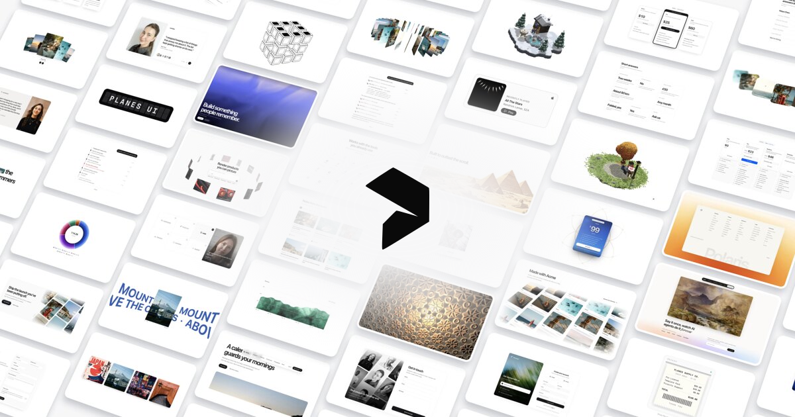

# Ashish Gogula

Full Stack AI and Design engineer. I like to build things people enjoy using, and I care about the last 10% of an interface: how it moves, sounds and feels under the cursor.


### Planes · [useplanes.com](https://useplanes.com)

230+ animated React components for shadcn, in 23 categories:

- **Page sections:** heroes, navbars, features, bento grids, pricing, testimonials, FAQs, CTAs, contact, waitlist, logins, footers
- **UI:** AI chat and agent interfaces, controls, carousels, cards and media, charts
- **Effects:** WebGL shader backgrounds, text effects, physics, voxel dioramas

They install with the shadcn CLI into your own repo, so the code is yours to edit.

<a href="https://useplanes.com"></a>

### Try one free

[Cover Flow](https://github.com/ashishgogula/coverflow), the iTunes-style carousel, is open source:

```bash
npx shadcn add https://useplanes.com/r/cover-flow.json
```

### Elsewhere

[Portfolio](https://ashishgogula.in) · [X](https://x.com/ashishgogula) · [LinkedIn](https://linkedin.com/in/ashishgogula)

[](https://holopin.io/@ashishgogula)
